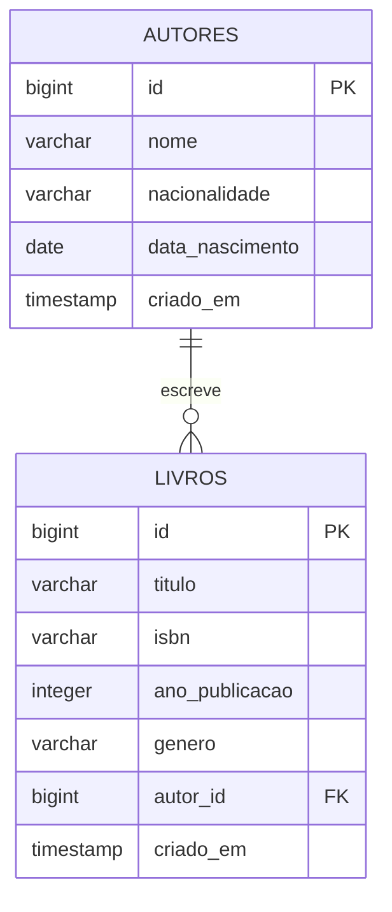

# 📚 Biblioteca Web

[](https://github.com/MateusViggiani/biblioteca-web/actions/workflows/ci-cd.yml)

Sistema web para cadastro de **Autores** e **Livros** (CRUD completo dos dois). Cada livro é escrito por um autor, e um autor pode ter vários livros: relacionamento **Autor (1) → Livro (N)**.

Projeto da disciplina de Engenharia de Software (Parte 2 – Laboratório), seguindo o mesmo fluxo de desenvolvimento do projeto Agenda Web.

## Tecnologias

| Camada | Tecnologia / versão |
|---|---|
| Backend | Java 17 + Spring Boot 3.2 (Web, Data JPA, Validation, Lombok) + Maven |
| Frontend | React 18 + React Router 6 + Axios (react-scripts 5) • Node.js 20 + npm |
| Banco de dados | PostgreSQL 15 (desenvolvimento) • H2 em memória (perfil `test`) |
| Testes | JUnit 5 + Mockito (`@WebMvcTest`, `@MockBean`, `MockMvc`) • `@SpringBootTest` |
| Versão / CI / Containers | Git + GitHub • GitHub Actions • Docker + Docker Compose |
| Documentação da API | Swagger (springdoc-openapi) |

## Modelo de dados



A chave estrangeira `autor_id` fica na tabela `livros` (lado N). No código, o relacionamento fica só em `Livro.java` (`@ManyToOne` + `@JoinColumn(name = "autor_id")`).

## Estrutura do projeto

```
biblioteca-web/
├── backend/
│   ├── pom.xml
│   ├── Dockerfile
│   └── src/
│       ├── main/java/com/biblioteca/
│       │   ├── model/          Autor.java, Livro.java
│       │   ├── repository/     AutorRepository.java, LivroRepository.java
│       │   └── controller/     AutorController.java, LivroController.java
│       ├── main/resources/     application.properties (PostgreSQL)
│       └── test/
│           ├── java/com/biblioteca/
│           │   ├── controller/ AutorControllerTest.java, LivroControllerTest.java
│           │   └── IntegracaoTest.java
│           └── resources/      application-test.properties (H2)
├── frontend/
│   ├── package.json
│   ├── Dockerfile
│   ├── nginx.conf
│   ├── public/
│   └── src/
│       ├── components/         AutorList, AutorForm, LivroList, LivroForm, Avatar
│       ├── services/api.js     autorService e livroService (Axios)
│       ├── App.js              menu e rotas
│       └── App.css
├── docker-compose.yml          backend + frontend + PostgreSQL 15
├── .github/workflows/ci-cd.yml pipeline de CI
└── README.md
```

## Endpoints da API

| Verbo | URL | O que faz | Status |
|---|---|---|---|
| POST | `/api/autores` | Cria um autor | 201 |
| GET | `/api/autores` | Lista todos (ordem: nome) | 200 |
| GET | `/api/autores/{id}` | Busca um autor | 200 / 404 |
| PUT | `/api/autores/{id}` | Atualiza um autor | 200 / 404 |
| DELETE | `/api/autores/{id}` | Remove um autor (409 se tiver livros) | 200 / 404 / 409 |
| POST | `/api/livros` | Cria um livro ligado a um autor | 201 / 400 |
| GET | `/api/livros` | Lista todos (ordem: título) | 200 |
| GET | `/api/livros/{id}` | Busca um livro | 200 / 404 |
| PUT | `/api/livros/{id}` | Atualiza um livro (inclusive o autor) | 200 / 404 |
| DELETE | `/api/livros/{id}` | Remove um livro | 200 / 404 |
| GET | `/api/livros/autor/{autorId}` | Lista os livros de um autor | 200 |

Exemplo para criar um livro (o autor vai só com o `id`):

```json
{ "titulo": "Dom Casmurro", "isbn": "978-8535910667", "anoPublicacao": 1899,
  "genero": "Romance", "autor": { "id": 1 } }
```

## Como executar

### Com Docker (tudo junto)

```bash
docker compose up -d --build
```

| Serviço | Endereço |
|---|---|
| Frontend | http://localhost:3000 |
| Backend (API) | http://localhost:8080/api/autores |
| Swagger | http://localhost:8080/swagger-ui.html |
| PostgreSQL 15 | `localhost:5434` (dentro do Docker: `postgres:5432`), banco `biblioteca_db`, usuário/senha `postgres` |

> O PostgreSQL do container fica na porta **5434** do computador para não conflitar com um PostgreSQL já instalado na 5432.

Para parar: `docker compose down` (ou `docker compose down -v` para apagar também os dados).

### Sem Docker (desenvolvimento)

Pré-requisitos: Java 17+, Maven, Node.js 20+ e um PostgreSQL rodando em `localhost:5432` com o banco `biblioteca_db` (usuário/senha `postgres`).

```bash
# Backend (porta 8080)
cd backend
mvn spring-boot:run

# Frontend (porta 3000), em outro terminal
cd frontend
npm install
npm start
```

## Como rodar os testes

```bash
cd backend
mvn test                              # todos (15 testes)
mvn test -Dtest="*ControllerTest"     # só os unitários (Mockito)
mvn test -Dtest="IntegracaoTest"      # só o de integração (H2)

cd ../frontend
npm test -- --watchAll=false --passWithNoTests
npm run build
```

| Classe | Tipo | O que testa |
|---|---|---|
| `AutorControllerTest` | Unitário (`@WebMvcTest`) | criar (201), validação (400), id inexistente (404), listagem ordenada, atualizar, deletar |
| `LivroControllerTest` | Unitário (`@WebMvcTest`) | criar com autor (201), sem autor / autor inexistente (400), id inexistente (404), listagem ordenada, atualizar trocando o autor, deletar inexistente (404) |
| `IntegracaoTest` | Integração (`@SpringBootTest` + H2) | `deveVincularLivroAAutor`, `deveExecutarFluxoCompletoAutor` |

## CI (GitHub Actions)

O workflow `.github/workflows/ci-cd.yml` roda a cada `push` e `pull_request` na `main`:

1. **test-backend**: Java 17 + `mvn test`
2. **test-frontend**: Node 20 + `npm ci`, `npm test` e `npm run build`
3. **deploy** (só em push na `main`): `docker compose build` + `up` e testes de aceitação com `curl` (cria um autor e um livro vinculado)

## Divisão do trabalho

| Integrante | Responsabilidade | Branch |
|---|---|---|
| DEV 1 – Mateus Viggiani | CRUD de Autores: `Autor.java`, `AutorRepository`, `AutorController`, `AutorControllerTest`, `AutorList.js`, `AutorForm.js` | `feature/autores` |
| DEV 2 – Mateus Viggiani | CRUD de Livros: `Livro.java`, `LivroRepository`, `LivroController`, `LivroControllerTest`, `IntegracaoTest`, `LivroList.js`, `LivroForm.js` | `feature/livros` |

Arquivos comuns (`api.js`, `App.js`, `docker-compose.yml`, CI e README) foram divididos entre as duas partes. Cada branch entrou na `main` por Pull Request com revisão (#1 e #2).
